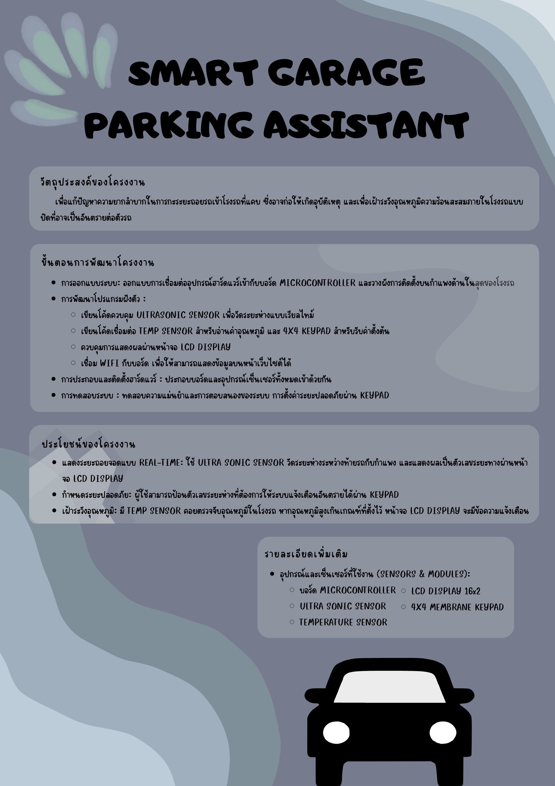

# Smart-Parking-Assistant-w-IOT

# 🌐 Live Website:
[https://Thosesky.github.io/Smart-Parking-Assistant-w-IOT/](https://Thosesky.github.io/Smart-Parking-Assistant-w-IOT/)

# 🎬 Video Demonstration:
- [รับชมวิดีโอแนะนำการทำงานโปรเจกต์บน YouTube](https://www.youtube.com/watch?v=_pCQ5SJIGoE)

# Poster

## โครงงาน: ระบบผู้ช่วยถอยจอดและเฝ้าระวังอุณหภูมิโรงรถ (Smart Parking Assistant)

### รายชื่อสมาชิกในกลุ่ม
1. 68070011 - คมนรงค์ แสนสินชัย
2. 68070178 - ศุภวิชญ์ ธาตุเสียว
3. 68070193 - สุวรรณภูมิ มูลเมือง

### จุดประสงค์ของโปรเจกต์
เพื่อแก้ปัญหาความยากลำบากในการกะระยะถอยรถเข้าโรงรถที่แคบ ซึ่งอาจก่อให้เกิดอุบัติเหตุ และเพื่อเฝ้าระวังอุณหภูมิความร้อนสะสมภายในโรงรถแบบปิดที่อาจเป็นอันตรายต่อตัวรถ

### รายละเอียดโปรเจกต์
ระบบนี้จะถูกติดตั้งไว้ที่กำแพงด้านในสุดของโรงรถ โดยมีการทำงานหลักดังนี้:
- **แสดงระยะถอยจอดแบบ Real-time:** ใช้ Ultra Sonic Sensor วัดระยะห่างระหว่างท้ายรถกับกำแพง และแสดงผลเป็นตัวเลขระยะทางผ่านหน้าจอ LCD เมื่อระยะห่างเลยระยะที่กำหนดจะมีข้อความ STOP
- **กำหนดระยะปลอดภัย:** ผู้ใช้สามารถป้อนตัวเลขระยะห่างที่ต้องการให้ระบบแจ้งเตือนอันตรายได้ผ่าน Keypad โดยการ กดเลขเพื่อตั้งระยะ กดAเพื่อsave กดCเพื่อclear
- **เฝ้าระวังอุณหภูมิ:** มี Temp Sensor คอยตรวจจับอุณหภูมิในโรงรถ หากอุณหภูมิสูงเกินเกณฑ์ที่ตั้งไว้ หน้าจอ LCD จะมีข้อความ OVERHEAT เพื่อแจ้งเตือนความเสี่ยง
- ส่ง distance และ temperature ไปหน้าเว็บไซต์

### อุปกรณ์ที่ใช้งาน (Sensors & Modules)
- บอร์ด Microcontroller
- Ultra Sonic Sensor
- Temperature Sensor
- 4x4 Membrane Keypad
- LCD
